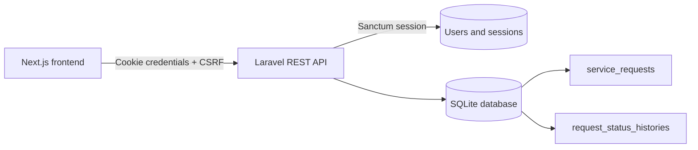
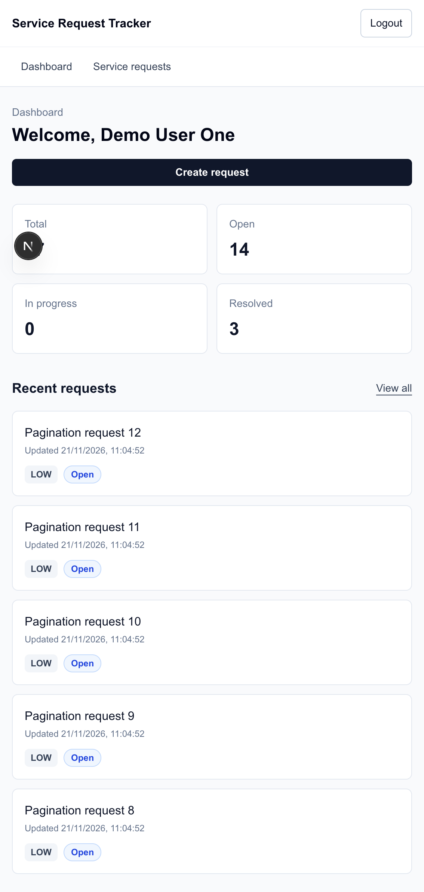
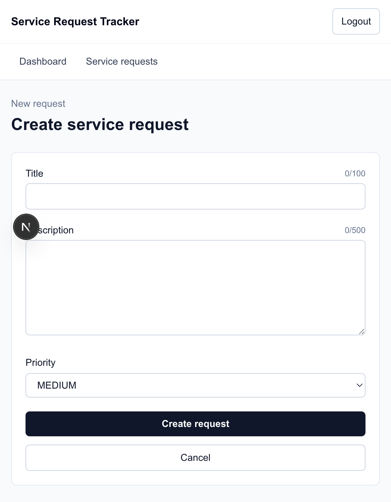
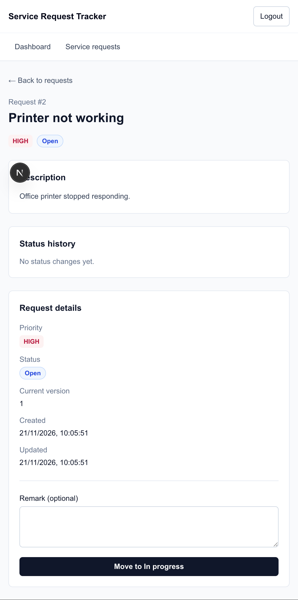
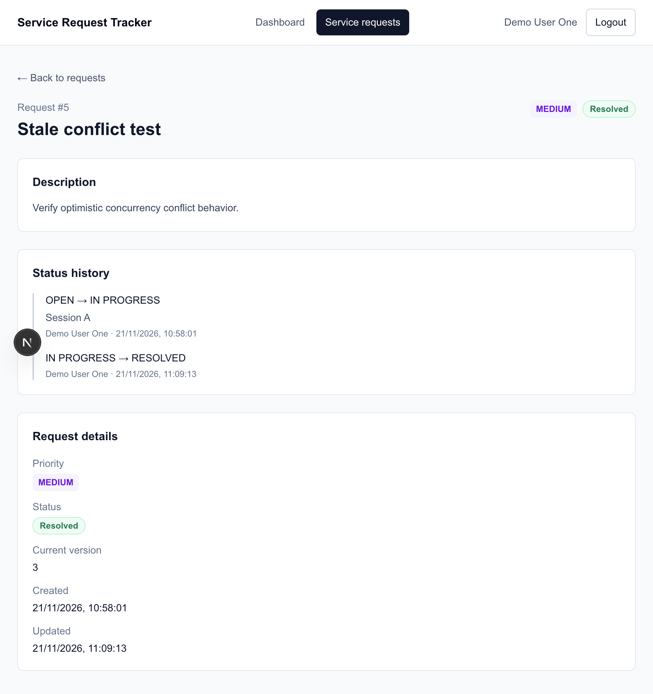

# Service Request Tracker

A full-stack application for employees to create and manage internal service requests. Each signed-in user can access only their own requests, and status changes follow an auditable workflow protected by optimistic concurrency.

## Technology Stack

### Backend
- PHP 8.6 (verified in the development environment)
- Laravel 13.43
- Laravel Sanctum 4.5
- SQLite
- Eloquent ORM
- PHPUnit 12

### Frontend
- Next.js 16 App Router
- React 19
- TypeScript
- Tailwind CSS 4
- Native Fetch API

### Authentication
- Sanctum cookie-based stateful SPA authentication
- Laravel web session guard
- HTTP-only session cookies
- CSRF protection
- Credentialed CORS

## Architecture



The frontend uses `http://localhost:3000` and the backend uses `http://localhost:8000`. Both services use `localhost` consistently because `localhost` and `127.0.0.1` are separate cookie hosts.

## Implemented Features

- Login, current-user lookup, and logout
- Two locally seeded demo users
- User-owned service request creation
- Server-side title search
- Combined status and priority filters
- Server-side pagination
- Request detail and status history views
- Controlled status transitions
- Optimistic expected-version concurrency
- Atomic status updates and audit history
- Responsive Next.js interface with loading, empty, validation, authorization, and conflict states

## Prerequisites

Verified environment:

- PHP 8.6
- Composer 2.11
- PHP SQLite extension
- Node.js 26.8
- npm 11.19
- SQLite 3

The Laravel Composer manifest declares PHP `^8.3` and Laravel `^13.17`.

## Installation

### Backend

```bash
cd backend
composer install
cp .env.example .env
php artisan key:generate
php artisan migrate
php artisan db:seed
php artisan serve --host=localhost --port=8000
```

### Frontend

In a separate terminal:

```bash
cd frontend
npm install
cp .env.example .env.local
npm run dev
```

Open `http://localhost:3000`.

The frontend environment value is:

```env
NEXT_PUBLIC_API_BASE_URL=http://localhost:8000
```

For local HTTP development, keep the session cookie settings on their local defaults: `SESSION_HTTP_ONLY=true`, `SESSION_SAME_SITE=lax`, and `SESSION_SECURE_COOKIE=false`. Production requires HTTPS and appropriate secure-cookie/domain settings.

## Demo Credentials

Both demo accounts use the same development password:

- User A: `user1@example.com` / `Password123!`
- User B: `user2@example.com` / `Password123!`

These credentials are for local development only.

## Running Tests

### Backend

```bash
cd backend
php artisan test
```

The automated suite includes authentication, ownership, request creation and validation, search and filters, pagination, status transitions, stale versions, history, and transaction rollback coverage.

### Frontend

```bash
cd frontend
npm run lint
npm run build
```

## API Documentation

All protected endpoints require an authenticated Sanctum session.

### Authentication

#### Initialize CSRF

```http
GET /sanctum/csrf-cookie
```

This must be called before login or state-changing requests. The frontend's login helper performs this initialization first.

#### Login

```http
POST /api/auth/login
Content-Type: application/json

{
  "email": "user1@example.com",
  "password": "Password123!"
}
```

Success: `200`

```json
{
  "message": "Login successful.",
  "data": {
    "user": {
      "id": 1,
      "name": "Demo User One",
      "email": "user1@example.com"
    }
  }
}
```

Invalid credentials return `422`.

#### Current user

```http
GET /api/auth/me
```

Success: `200` with `data.user`. Unauthenticated: `401`.

#### Logout

```http
POST /api/auth/logout
```

The server invalidates the current session and regenerates the CSRF token. Success: `200`. Unauthenticated: `401`.

### Service Requests

#### Create request

```http
POST /api/requests
Content-Type: application/json

{
  "title": "Printer not working",
  "description": "Office printer stopped responding.",
  "priority": "HIGH"
}
```

Success: `201` with the created request in `data`. Validation errors: `422`. Unauthenticated: `401`.

The server sets `created_by`, `status=OPEN`, and `version=1`; client-protected fields are ignored.

#### List requests

```http
GET /api/requests?search=printer&status=OPEN&priority=HIGH&page=1&per_page=10
```

Query parameters:

- `search`: partial title search
- `status`: `OPEN`, `IN_PROGRESS`, or `RESOLVED`
- `priority`: `LOW`, `MEDIUM`, or `HIGH`
- `page`: positive integer
- `per_page`: positive integer, maximum `25`

Default page size is `10`. Invalid filters or pagination values return `422`. Results contain only the authenticated user's requests, newest first.

Example response:

```json
{
  "data": [],
  "meta": {
    "current_page": 1,
    "per_page": 10,
    "total": 0,
    "last_page": 1
  }
}
```

#### Request detail

```http
GET /api/requests/{id}
```

Success: `200` with `data`. Unknown or non-owned requests return `404`. Unauthenticated: `401`.

#### Update status

```http
PATCH /api/requests/{id}/status
Content-Type: application/json

{
  "status": "IN_PROGRESS",
  "expected_version": 1,
  "remark": "Technician assigned"
}
```

Success: `200` with the updated request in `data`. Invalid fields: `422`. Invalid workflow transition: `409` with `INVALID_TRANSITION`. Stale version: `409` with `STALE_VERSION`. Unknown or non-owned requests: `404`. Unauthenticated: `401`.

#### Status history

```http
GET /api/requests/{id}/history
```

Success: `200` with oldest-first `data`. Requests without history return `{"data":[]}`. Unknown or non-owned requests: `404`. Unauthenticated: `401`.

Each history record contains `id`, `from_status`, `to_status`, `remark`, safe `actor` information, and `created_at`.

## Business Rules

```text
OPEN -> IN_PROGRESS -> RESOLVED
```

- `RESOLVED` is terminal.
- Skipping, reversing, reopening, and duplicate transitions are prohibited.
- New requests start at `OPEN` with version `1`.
- Every successful transition increments version exactly once.
- Status updates require `expected_version`.
- The database update matches request ID, owner, persisted status, and expected version.
- Stale updates return `409` and do not create history.
- Invalid transitions return `409` and do not change the request.
- Status update and history insertion share one database transaction.

## Security

- Passwords are hashed by Laravel.
- SPA authentication uses Sanctum sessions rather than browser-stored bearer tokens.
- Session cookies are HTTP-only and CSRF is not disabled.
- CORS is restricted to the local frontend origin with credentialed requests enabled.
- Every service request query is scoped to the authenticated user.
- Unknown and non-owned request IDs return `404` consistently.
- User responses expose only public identity fields.
- Protected ownership, status, version, actor, and history fields cannot be supplied as client-controlled data.
- `.env`, `.env.local`, SQLite databases, dependencies, logs, and build outputs are excluded from Git.

## Screenshots












## Known Limitations

- Browser automation is not installed as a repeatable frontend test suite; key browser flows were verified manually.
- Multi-process SQLite concurrency was not tested. The implementation uses a conditional versioned database update and transaction, but SQLite locking differs from some production databases.
- Formal automated network-failure and responsive viewport tests are not included.

## AI Use & Verification

1. **AI tools used:** GitHub Copilot / Copilot SDK in VS Code.
2. **Areas assisted:** Laravel and Next.js implementation, debugging, automated tests, documentation, screenshot preparation, and final QA.
3. **Representative prompt/advice:** Phase-by-phase implementation specifications included Sanctum cookie authentication, ownership-scoped APIs, optimistic concurrency, atomic history insertion, and full-stack browser verification.
4. **Independent verification:** AI-generated changes were reviewed against the Laravel routes, controllers, Form Requests, resources, migrations, frontend source, and assignment requirements. Verified using PHPUnit, Laravel route/migration commands, curl, ESLint, Next.js build, and browser interaction.
5. **Corrections after testing:** Session middleware, ownership-safe 404 responses, wildcard-character search handling, loading-state cleanup, logout failure feedback, and stale 409 refresh behavior were corrected after tests or browser review.
6. **Independent technical decision:** The project uses user-scoped relationship queries and 404 responses for unknown or non-owned requests rather than trusting a client-supplied owner or returning separate user-specific errors. This keeps authorization at the backend boundary and avoids exposing resource existence.

## Verification Results

- Backend: 37 tests passed, 197 assertions passed.
- Frontend ESLint: passed.
- Frontend production build: passed.
- Laravel routes: 13 routes verified.
- Migrations: all migration files applied.
- Composer security audit: no known advisories found at verification time.
- Browser verification: login, logout, dashboard, owner-scoped requests, creation, search and filters, pagination, detail, history, status transitions, and stale 409 refresh behavior were exercised with the real application.
