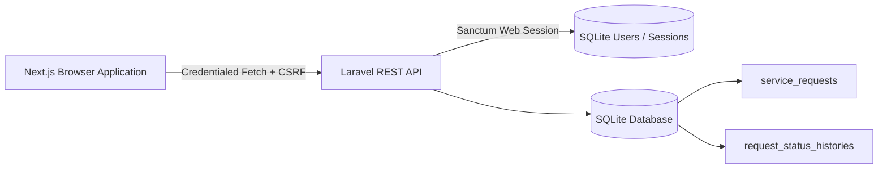
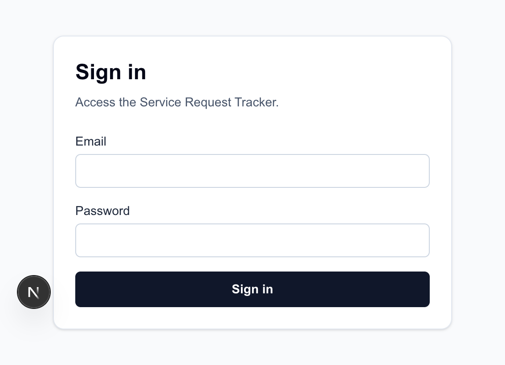
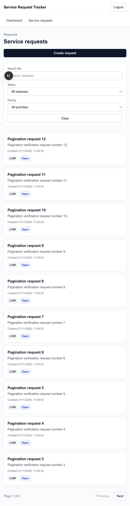
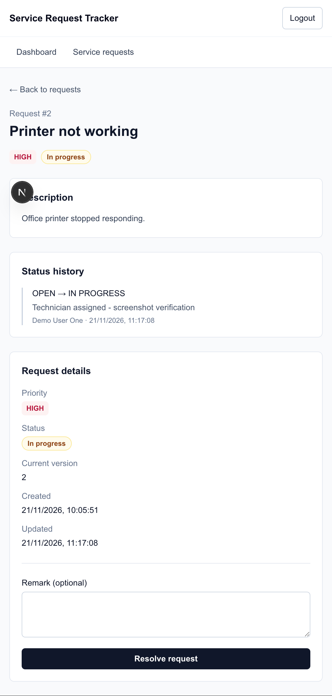
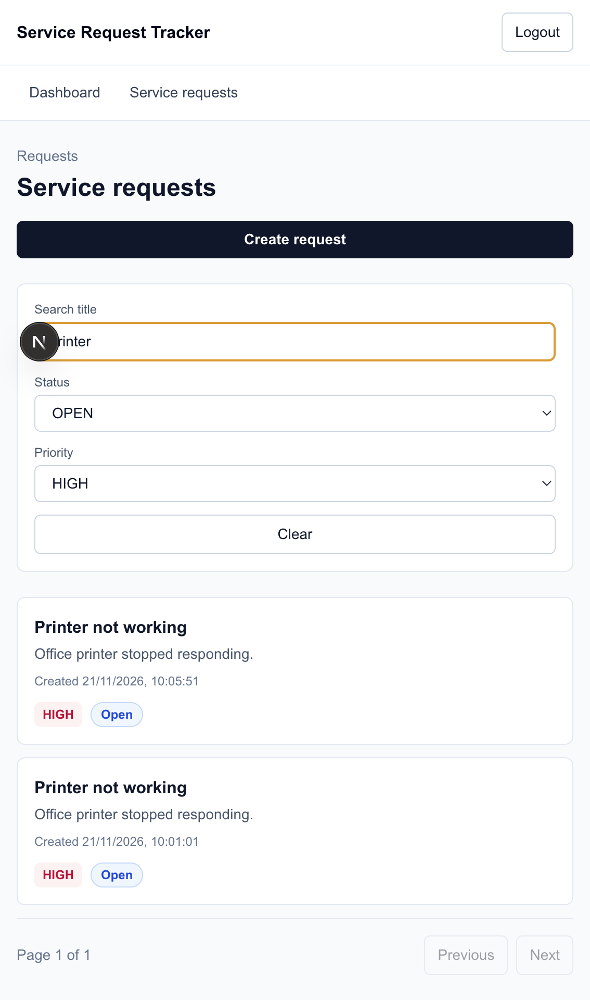
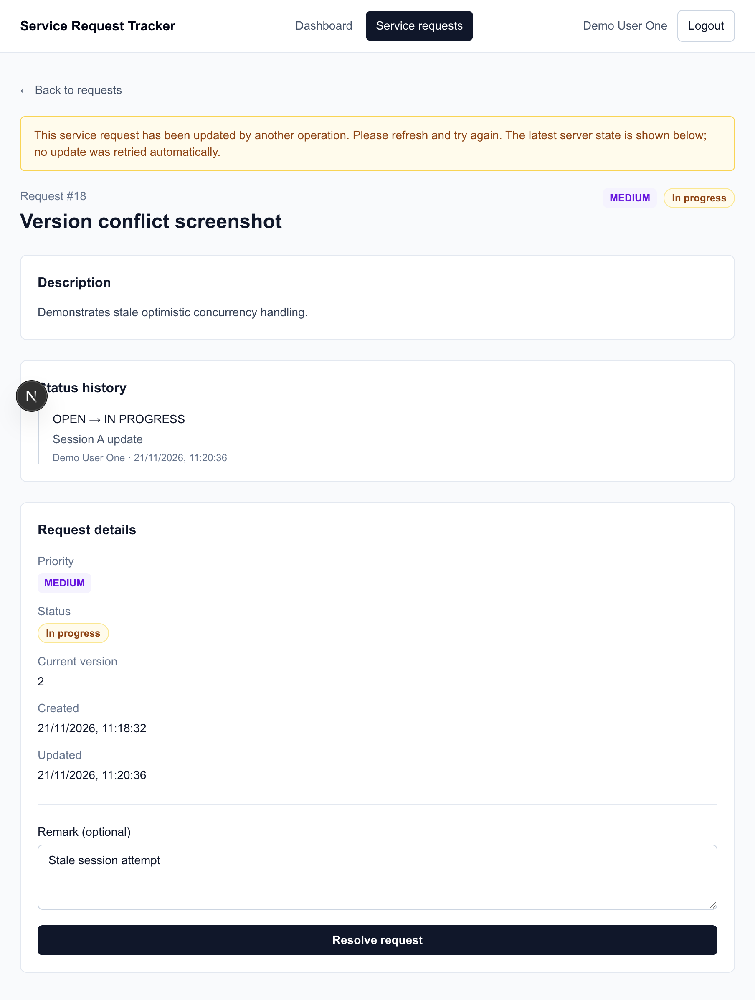

# Service Request Tracker

## Project Overview

Service Request Tracker is a full-stack assessment application for creating, viewing, searching, filtering, and resolving service requests. Users authenticate with a shared Laravel session, create owned requests, and follow an enforced status workflow.

## Technology Stack

### Backend
- PHP 8.6 (verified development environment)
- Laravel 13
- Laravel Sanctum 4
- PHPUnit 12
- SQLite
- Eloquent ORM

### Frontend
- Next.js 16 App Router
- React 19
- TypeScript
- Tailwind CSS 4
- Native Fetch API

### Authentication
- Stateful Sanctum SPA authentication
- Laravel web session guard
- HTTP-only cookies and CSRF protection

## Architecture Overview



The frontend at `http://localhost:3000` communicates with Laravel at `http://localhost:8000`. Both services must use `localhost`; `localhost` and `127.0.0.1` are different cookie hosts.

## Features

- Sanctum login, current-user lookup, and logout
- Two seeded demo users
- Authenticated service request creation
- Owner-scoped request listing and detail views
- Database title search
- Status and priority filters
- Server-side pagination
- Status workflow and status history
- Optimistic version concurrency
- Atomic status updates and history insertion
- Responsive Next.js interface

## Prerequisites

Verified environment:

- PHP 8.6 CLI
- Composer 2.11
- PHP SQLite extension
- Node.js 26.8
- npm 11.19
- SQLite 3

The Composer manifest supports PHP `^8.3`; PHP 8.6 was used for verification.

## Installation and Setup

Clone the repository and install both applications:

```bash
cd service-request-tracker

cd backend
composer install
cp .env.example .env
php artisan key:generate
php artisan migrate
php artisan db:seed

cd ../frontend
npm install
cp .env.example .env.local
npm run dev
```

In another terminal, start Laravel:

```bash
cd backend
php artisan serve --host=localhost --port=8000
```

Frontend URL: `http://localhost:3000`  
Backend URL: `http://localhost:8000`

Keep `SESSION_DOMAIN=null`, `SESSION_HTTP_ONLY=true`, `SESSION_SAME_SITE=lax`, and `SESSION_SECURE_COOKIE=false` for local HTTP development. Production requires HTTPS and an appropriate secure-cookie/domain configuration.

Frontend environment:

```env
NEXT_PUBLIC_API_BASE_URL=http://localhost:8000
```

## Demo Credentials

Development-only credentials:

- User A: `user1@example.com` / `Password123!`
- User B: `user2@example.com` / `Password123!`

Do not reuse these demo credentials outside local development.

## Running Tests

Backend:

```bash
cd backend
php artisan test
```

Frontend:

```bash
cd frontend
npm run lint
npm run build
```

The current backend suite covers authentication, database relationships, request CRUD reads/creation, ownership, filtering, pagination, status transitions, stale versions, history, and transaction rollback. The frontend has no dedicated test framework configured; browser verification was performed manually.

## API Documentation

All API endpoints except login and CSRF initialization require the authenticated Sanctum session.

### Authentication

#### Initialize CSRF

```http
GET /sanctum/csrf-cookie
```

#### Login

```http
POST /api/auth/login
Content-Type: application/json

{
  "email": "user1@example.com",
  "password": "Password123!"
}
```

Success: `200`

```json
{
  "message": "Login successful.",
  "data": {
    "user": {
      "id": 1,
      "name": "Demo User One",
      "email": "user1@example.com"
    }
  }
}
```

Invalid credentials: `422`.

#### Current user

```http
GET /api/auth/me
```

Success: `200` with `data.user`. Unauthenticated: `401`.

#### Logout

```http
POST /api/auth/logout
```

Success: `200` with a success message. Unauthenticated: `401`.

### Service Requests

#### Create

```http
POST /api/requests
Content-Type: application/json

{
  "title": "Printer not working",
  "description": "Office printer stopped responding.",
  "priority": "HIGH"
}
```

Success: `201` with the created request in `data`. Validation failures: `422`. Unauthenticated: `401`.

`created_by`, `status`, and `version` are server-controlled and cannot be overridden.

#### List

```http
GET /api/requests?search=printer&status=OPEN&priority=HIGH&page=1&per_page=10
```

Query parameters:

- `search`: title substring
- `status`: `OPEN`, `IN_PROGRESS`, or `RESOLVED`
- `priority`: `LOW`, `MEDIUM`, or `HIGH`
- `page`: integer, minimum 1
- `per_page`: integer, 1–25

Success response:

```json
{
  "data": [],
  "meta": {
    "current_page": 1,
    "per_page": 10,
    "total": 0,
    "last_page": 1
  }
}
```

Results are owned by the authenticated user and ordered newest first.

#### Detail

```http
GET /api/requests/{id}
```

Success: `200` with `data`. Unknown or non-owned ID: `404`. Unauthenticated: `401`.

#### Update status

```http
PATCH /api/requests/{id}/status
Content-Type: application/json

{
  "status": "IN_PROGRESS",
  "expected_version": 1,
  "remark": "Technician assigned"
}
```

Success: `200` with the updated request in `data`. Invalid payload: `422`. Invalid transition: `409` with `INVALID_TRANSITION`. Stale version: `409` with `STALE_VERSION`. Unknown or non-owned ID: `404`. Unauthenticated: `401`.

#### History

```http
GET /api/requests/{id}/history
```

Success: `200` with `data` containing oldest-first history records. An empty history is `{"data":[]}`. Unknown or non-owned ID: `404`. Unauthenticated: `401`.

## Business Rules

Only these transitions are allowed:

```text
OPEN -> IN_PROGRESS -> RESOLVED
```

- `RESOLVED` is terminal.
- Skipping, reversing, reopening, and duplicate transitions are rejected.
- A newly created request starts at status `OPEN` and version `1`.
- Every successful transition increments the version exactly once.
- Updates require `expected_version`.
- Stale versions return HTTP 409 with `STALE_VERSION`.
- Invalid transitions return HTTP 409 with `INVALID_TRANSITION`.
- Request updates and history insertion occur in one database transaction.

## Security Considerations

- Passwords are hashed through Laravel's authentication facilities.
- Sanctum uses stateful session authentication and HTTP-only cookies.
- CSRF protection remains enabled.
- CORS allows only `http://localhost:3000` locally with credentialed requests.
- Request ownership is always derived from the authenticated user.
- User and request APIs avoid exposing password hashes or internal protected fields.
- Create and status update payloads reject or ignore protected identity fields.
- Status updates use a conditional database update matching ownership, status, and expected version.
- `.env`, `.env.local`, SQLite databases, dependencies, and framework build outputs are ignored.

## Screenshots













## Known Limitations

- No dedicated frontend test framework is configured.
- Multi-process SQLite concurrency was not tested; the implementation uses conditional updates and database transactions, but SQLite locking behavior is not identical to production databases.
- Formal mobile and tablet browser viewport testing remains manual.
- Some network-failure and unexpected-response scenarios require manual browser verification.

## AI Use & Verification

1. **AI tools used:** GitHub Copilot / Copilot SDK in VS Code.
2. **Areas assisted:** Backend API implementation, frontend implementation, Laravel tests, documentation, code review, and integration verification.
3. **Representative prompts/advice received:** Phase-by-phase implementation specifications, error diagnosis, test design, and final repository cleanup guidance.
4. **Independent review:** AI-generated changes were reviewed against the Laravel routes/controllers/resources and Next.js source, then exercised with PHPUnit, ESLint, Next.js build, curl, and browser interaction.
5. **Corrections made:** During implementation and QA, session middleware, 404 ownership responses, literal search behavior, loading-state handling, logout error handling, and stale 409 refresh behavior were corrected after testing.
6. **Independent technical decision:** The project uses the authenticated Laravel relationship and user-scoped queries instead of trusting client ownership fields. This keeps ownership enforcement at the backend boundary and provides consistent 404 responses for unknown or non-owned resources.

## Assessment Traceability

| Requirement | Implementation | Verification | Result |
|---|---|---|---|
| Laravel REST API | `backend/routes/api.php`, API controllers | Route list and HTTP integration | PASS |
| Next.js frontend | `frontend/src/app` | Browser review, lint, build | PASS |
| SQLite and migrations | `backend/database/migrations` | Migration status and tests | PASS |
| Sanctum authentication | Auth controller, Sanctum config, session middleware | Browser login/logout and backend tests | PASS |
| Two demo users | `database/seeders/DemoUserSeeder.php` | Seeder test and browser login | PASS |
| Request ownership | User relationship queries | Backend tests and User A/User B browser test | PASS |
| Creation and validation | Form Request and API resource | Backend tests and browser validation | PASS |
| Search and filters | Eloquent query composition | Backend tests and browser interaction | PASS |
| Server-side pagination | Laravel paginator | Backend tests and browser page navigation | PASS |
| Request detail | Owner-scoped detail endpoint | Backend tests and browser detail view | PASS |
| Allowed transitions | `RequestStatusService` | Backend tests and browser transitions | PASS |
| Optimistic concurrency | Conditional versioned update | Backend tests and independent API sessions | PASS |
| Transactional history | Database transaction and history model | Backend tests and browser history | PASS |
| HTTP status handling | Controllers and API resources | Automated and manual verification | PASS |
| Automated backend tests | `backend/tests/Feature` | 37 tests, 197 assertions | PASS |
| Frontend lint/build | npm scripts | ESLint and Next build passed | PASS |
| README setup | Root README | Manual review | PASS |
| AI Use & Verification | This section | Manual review | PASS |
| Screenshots | `screenshots/` | Login, dashboard, list, create, detail, history, transition, filters, and conflict images captured | PASS |
| GitHub repository readiness | Git status and ignore rules | No secrets tracked; review pending commit | NOT VERIFIED |

## Submission Checklist

Replace placeholders before submission:

- Repository URL: `[TO BE PROVIDED]`
- Branch: `[TO BE PROVIDED]`
- Final commit hash: `[TO BE PROVIDED]`

Before submission:

1. Review `git status`.
2. Add intended source and documentation files.
3. Verify no `.env`, `.env.local`, SQLite database, vendor, node_modules, or `.next` files are staged.
4. Commit the final changes.
5. Push only after explicit approval.

Useful Git commands:

```bash
git status
git diff --stat
git diff
git add README.md backend frontend screenshots
git diff --cached --stat
git commit -m "docs: finalize assessment documentation"
```
